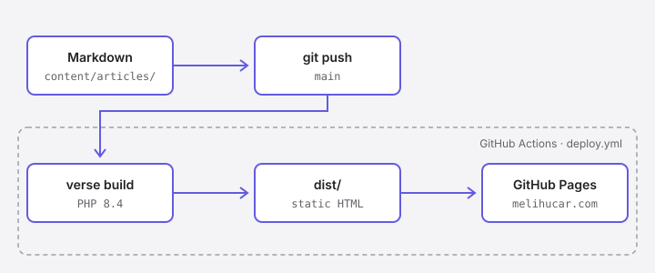

This is the first article written for this site rather than linked from somewhere else, so it seems fair to start with the site itself: what it is made of, how a Markdown file becomes a page at melihucar.com, and what I deliberately left out.

## The short version

Every page here is a Markdown file in a Git repository. When I push to `main`, a GitHub Actions workflow builds the site with [Verse](https://github.com/astrophp/verse) and publishes the result to GitHub Pages. There is no server, no database, and no admin panel.



## Content is just files

The repository is small enough to describe in full:

```text
verse.yaml
content/
  about.md
  projects.md
  articles/
    how-this-site-is-built/
      page.md
      pipeline.svg
.github/workflows/deploy.yml
```

`verse.yaml` holds the site-wide settings: title, URL, description, and social links. Everything else is content. An article is either a single Markdown file or, like this one, a folder with a `page.md` and the assets it uses. Keeping the diagram next to the text means I can move or rename the article without hunting down broken image paths.

Each file starts with a little front matter:

```yaml
---
title: How This Site Is Built
description: Markdown files, a small PHP static site generator, and one GitHub Actions workflow.
date: 2026-10-21
tags: [Verse, AstroPHP, GitHub Pages, Static Sites]
---
```

Some articles here live on Medium. For those, the front matter has an `external_url` and the article list links straight to it. Writing a page natively or pointing to it elsewhere is one line of difference. From now on, this site is where articles are published first; Medium is there for reach.

## Why Verse

Verse is a static site generator I'm building under [AstroPHP](https://github.com/astrophp). I spend most of my time in PHP and Laravel, and I wanted the tool behind my own writing to live in the same ecosystem: templates are Blade, content is Markdown, and the output is plain HTML.

The other reason is simpler: building things is fun, and it teaches you more than using them. Writing a static site generator means deciding how Markdown becomes HTML, how links between pages resolve, and what a build should refuse to publish. Those are small questions, but answering them yourself is a good way to learn.

## The whole deploy pipeline

This is the entire workflow:

```yaml
name: deploy

on:
  push:
    branches: [main]
  workflow_dispatch:

permissions:
  contents: read
  pages: write
  id-token: write

jobs:
  build:
    runs-on: ubuntu-latest
    steps:
      - uses: actions/checkout@v7

      - uses: shivammathur/setup-php@v2
        with:
          php-version: '8.4'
          extensions: intl, mbstring

      - name: Install Verse
        run: |
          composer global require astrophp/verse --no-interaction
          echo "$(composer global config bin-dir --absolute --quiet)" >> "$GITHUB_PATH"

      - run: verse build

      - uses: actions/upload-pages-artifact@v5
        with:
          path: dist

  deploy:
    needs: build
    runs-on: ubuntu-latest
    environment:
      name: github-pages
    steps:
      - uses: actions/deploy-pages@v5
```

The build job installs PHP, installs Verse with Composer, and runs `verse build`, which writes the finished site to `dist/`. That folder is uploaded as a Pages artifact, and the deploy job publishes it. Nothing is committed back to the repository; there is no `gh-pages` branch to keep in sync.

The `permissions` block is worth a note. `pages: write` and `id-token: write` are what let `deploy-pages` publish without a personal access token stored in secrets.

## Writing locally

Locally, the loop is two commands:

```bash
verse serve
verse check
```

`verse serve` previews the site and rebuilds on every save. `verse check` validates the site without writing anything, which is a quick sanity pass before pushing. Articles marked `draft: true` show up in the preview with a badge but are never part of a real build, so unfinished work can sit in the repository safely.

## What I left out

I want this site to stay slim: HTML and CSS first, everything else only when it earns its place.

- **Comments.** They would mean a third-party script or a server, and neither fits a site that is just files. If something here is worth discussing, I'd rather hear about it on [LinkedIn](https://www.linkedin.com/in/melihucar/) or in a [GitHub issue](https://github.com/melihucar/melihucar.com/issues).
- **A JavaScript framework.** JavaScript is used only where a feature needs it, such as the copy button on code blocks.

> [!NOTE]
> A newsletter is planned for a future release. Until then, [LinkedIn](https://www.linkedin.com/in/melihucar/) and [GitHub](https://github.com/melihucar) are the best places to follow along.

## What comes next

The articles here will mostly be about software architecture, AI systems, and the Laravel ecosystem: following a problem from the first question to the decisions that remain. This one had a second job too. It is the first page to go through the entire pipeline above, so if you're reading it at melihucar.com, that part works.
