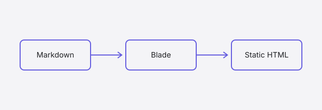

# Markdown showcase

This page shows every Markdown feature the default theme renders. It is a **draft**, so it appears in `verse serve` with a Draft badge and is never published by `verse build`. Copy whatever you need from the source file, `content/articles/markdown-showcase/page.md`.

## Text

A paragraph with **bold**, *italic*, ***both***, and `inline code`. Typographic characters work as written: “quotes”, an em dash — like this, and an ellipsis…

A line can end with a backslash to force a line break\
so this sentence starts on a new line within the same paragraph.

Raw HTML is shown as text, never executed: <script>alert('nope')</script> and <strong>this</strong> stay literal.

---

The line above is a horizontal rule (`---` on its own line).

## Links

- An external link: [Trail on GitHub](https://github.com/astrophp/trail).
- A link to another page by its source file — Verse turns it into the final URL: [About](../../about.md).
- A link to an article by its source file; for an external article it becomes the external URL: [The bug hiding in a successful Laravel AI agent](../the-bug-hiding-in-a-successful-laravel-ai-agent.md).
- A link to a heading on this page: [jump to Code](#code).
- A link to a file in this article's folder: [the diagram as a file](diagram.svg).
- A site-relative link (the base path is added automatically): [Tags](/articles/tags/).
- Unsafe links are removed: [this one](javascript:alert(1)) keeps its text but loses the link.

## Lists

An unordered list:

- First item
- Second item, with a nested list:
  - Nested item
  - Another nested item
- Third item

An ordered list:

1. Identify the subject the request refers to.
2. Check which evidence entered the run.
3. Locate the first point where the relationship changed.

## Quotes and callouts

> A plain blockquote. The useful question is not only “Did the run succeed?” It is also “What made this answer possible?”

> [!NOTE] A note with a title
> Callouts use GitHub's alert syntax. The text after the marker becomes the title.

> [!TIP]
> Without a title, the kind is used as the title.

> [!IMPORTANT] Important
> Callouts can hold several paragraphs.
>
> - and lists,
> - and **formatting**.

> [!WARNING] Warning
> Each kind has its own colour: note blue, tip green, important violet, warning amber, caution red.

> [!CAUTION] Caution
> NOTE, TIP, IMPORTANT, WARNING and CAUTION are the supported kinds.

## Code

A fenced block with a language gets a label, syntax highlighting, and a Copy button:

```php
<?php

final class TraceRecorder
{
    public function record(Run $run, Subject $subject, Evidence $evidence): void
    {
        if ($evidence->subjectId !== $subject->id) {
            throw new MismatchedEvidence('Evidence belongs to another subject');
        }

        $this->links[] = [$run->id, $subject->id, $evidence->id];
    }
}
```

Blade, JavaScript, JSON, YAML, shell and diffs are highlighted too. Blade and PHP inside Markdown are only ever shown, never run:

```blade
@foreach ($runs as $run)
    <x-run-card :run="$run" />
@endforeach
{{ $total }} runs
```

```js
const results = items.filter((item) => item.tags.includes('Laravel'))
console.log(`${results.length} matches`)
```

```json
{ "title": "Trail", "tags": ["Laravel", "AI observability"] }
```

```yaml
title: Articles
menu: true
home: true
tags: true
```

```bash
cd ~/Repositories/personal/melihucar-com
verse serve --port=8080
```

```diff
- $answer = $agent->run($request);
+ $answer = $agent->run($request, trace: true);
```

A block without a language is labelled “Code” and not highlighted:

```
run = begin_trace(request)
subject = resolve_subject(request)
evidence = fetch_history(subject.id)
```

Long lines scroll sideways instead of wrapping:

```text
This line is deliberately very long so that the code block has to scroll horizontally on narrow screens instead of wrapping the text onto several lines.
```

Indenting by four spaces also makes a code block:

    indented code block
    second line

### A smaller heading

Level-three headings appear in the table of contents too. Every heading gets an ID from its text, so links like [#a-smaller-heading](#a-smaller-heading) keep working.

## Tables

| Stage | Question to ask | Status |
| :--- | :--- | ---: |
| Selection | Which listing did the agent resolve? | 1 |
| Retrieval | Does the history belong to that listing? | 2 |
| Response | Which evidence supports the explanation? | 3 |

Wide tables scroll sideways on small screens:

| Run | Model | Step | Tool | Input | Output | Duration | Tokens | Cost | Result |
| --- | --- | --- | --- | --- | --- | --- | --- | --- | --- |
| 42 | gpt | plan | search | “listing 17” | 3 results | 1.2 s | 812 | $0.002 | ok |
| 43 | gpt | answer | — | history | summary | 0.8 s | 404 | $0.001 | wrong subject |

## Images

An image with a title becomes a figure with a caption:



An image without a title is shown on its own:


## Footnotes

Footnotes are numbered automatically[^trace] and listed at the end of the article.[^second]

[^trace]: A trace is the recorded sequence of steps behind one response.
[^second]: Footnotes can contain **formatting** and [links](https://github.com/astrophp/trail).
