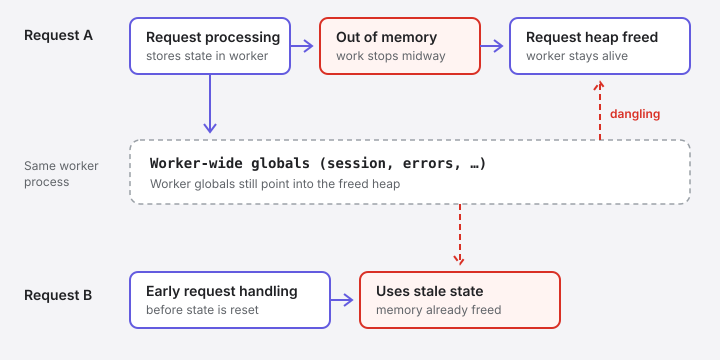

> [!CAUTION] Patch first, read later
> If you run PHP that serves web requests, update to **PHP 8.5.12, 8.4.27, 8.3.36 or 8.2.35** and restart every worker. According to the PHP team, there is no complete configuration workaround.[^php] This article was written on 21 October 2026, the day the fixes were released.

On 21 October 2026, PHP shipped fixes for two critical vulnerabilities, CVE-2026-109618 and CVE-2026-109619, which the researchers named **PHP2Shell**. Both are rated 9.2 on CVSS v4. Under the right conditions, an unauthenticated HTTP request can execute code on the server or read memory belonging to other requests, before your application code runs at all.[^ghsa-618][^ghsa-619]

The bug is not in WordPress, Drupal or any other application or framework. It is in how the PHP engine behaves when it runs out of memory, and the idea behind it is more than twenty years old.

This article covers what broke, how it was found, how PHP fixed it, and what to do about it. It deliberately stays high level; the official advisories and the researchers' write-ups linked at the end have the technical detail.

## The short version

- The bugs are in the PHP engine, in what happens when a request **runs out of memory** or hits another fatal error at the wrong moment.
- In those cases PHP could abandon work halfway through, and **leftover state could survive into the next request** handled by the same worker process.
- The researchers turned that into memory disclosure and unauthenticated remote code execution. Their demonstrations covered widely used PHP applications and frameworks, including WordPress, Drupal, Joomla, Magento, MediaWiki, Nextcloud, Laravel and Symfony.[^calif][^wiz]
- The fix changes how PHP handles running out of memory, and resets leftover state between requests.

## An old idea, rediscovered

The research write-up from [Calif](https://calif.io/), one of the teams that found the bugs, starts in 2004. That year, Stefan Esser, then PHP's best-known security researcher, found the first remote vulnerability built on `memory_limit`. He considered it severe enough that he never published his exploit.[^calif]

The same pattern kept resurfacing:

- **2020:** PHP bug #78876 reported that long variables in `multipart/form-data` requests could cause out-of-memory errors and leave temporary files behind. It was treated as a minor bug.[^bug78876]
- **2024:** an audit of PHP by [OSTIF](https://ostif.org/) and [Quarkslab](https://www.quarkslab.com/) found a related out-of-memory issue. Exploitation wasn't proven, so it wasn't treated as a security vulnerability.[^calif]
- **2026:** three groups found exploitable paths independently, within weeks of each other.

## How it was found

**Calif** started auditing PHP in late July as part of OpenAI's [*Patch the Planet*](https://openai.com/index/patch-the-planet/) initiative, with the PHP Foundation involved from the start. Their researcher, Ryan Austin, didn't ask a model to find all the bugs. He knew PHP's vulnerability history, so he asked it specifically for modern relatives of Esser's 2004 bug. Within days, on 1 August, that produced the first out-of-memory interruption leading to code execution. They then had the model generalise the pattern and search for similar code, which turned up more variants.[^calif]

Calif notes that no special tooling or unreleased models were used for the initial discovery. As they put it, "know your target" still matters.[^calif]

**[Wiz Research](https://www.wiz.io/research)** found the first of its bugs on 19 August using its Wiz Atlas platform, Gemini 4 Argon and GPT-5.6 Sol. It confirmed unauthenticated RCE against Drupal the next day and against WordPress the day after. Wiz also found a related variant in OPcache.[^wiz] **OpenAI's [Codex Security](https://developers.openai.com/codex/security)** team is credited as a reporter too.[^site]

| Date (2026) | Event |
| :--- | :--- |
| 1 August | Calif finds multiple RCE paths |
| 11 August | Calif reports the first bug to PHP |
| 15 August | PHP confirms Calif's proof of concept |
| 19 August | Wiz finds its first variant |
| 24 August | Wiz reports to PHP |
| 20 October | Details leak; PHP announces a release for the next day |
| 21 October, 14:00 UTC | Fixed releases and write-ups published |

The dates come from Calif's and Wiz's own timelines.[^calif][^wiz]

### The leak

The planned disclosure date was Thursday, 22 October. On 20 October, a Hacker News post announced two critical PHP RCEs with that date and both CVE identifiers, with no technical detail. [watchTowr](https://watchtowr.com/) confirmed the leak was real.[^thn] That evening PHP announced a release for 21 October at 14:00 UTC, a day earlier than planned.[^php] Cloudflare says it had deployed WAF rules about nine hours before disclosure and had already seen attack traffic aimed at its customers before the release.[^cloudflare]

## What went wrong, briefly

PHP enforces `memory_limit` per request. Before the fix, hitting the limit stopped the current operation immediately, wherever it was. Most of the time that's harmless: the request fails with "Allowed memory size exhausted" and the worker moves on.

The problem is the rare moment when PHP is in the middle of updating its own internal data. Stopping there can leave that data half-updated, or leave a worker-wide pointer aimed at memory that has already been freed. Some of PHP's request handling, including multipart form parsing and session upload progress, runs *before* your application code and before PHP has fully reset itself for the new request. That made it possible to reach the leftover state without any help from the application.[^ghsa-619]



PHP tracks the two CVEs as two classes of the same problem:

- **CVE-2026-109618, "RCE via OOM corruption":** running out of memory interrupts PHP while internal request data is only partially initialised.[^ghsa-618]
- **CVE-2026-109619, "RCE via stale global state":** state owned by one request survives after its memory is freed, and a later request on the same worker uses it.[^ghsa-619]

How exposed you were depends on how PHP is run. PHP rates **Apache with mod_php** as highest risk, with a demonstrated attack before any application code runs. **PHP-FPM**, FrankenPHP, php-cgi and LiteSpeed are also listed as affected.[^php] For the full technical analysis, read PHP's two advisories and the write-ups from Calif and Wiz.

## The fix

The patch is a single large commit, "Avoid state corruption via bailout", applied to all four supported branches.[^fix] Most of its roughly 11,700 changed lines are new tests that deliberately run PHP out of memory inside hundreds of functions. The change in behaviour comes down to three things:

- **Running out of memory no longer stops PHP mid-operation.** Hitting `memory_limit` is now recorded and handled at the next safe point, where PHP can unwind cleanly and report the usual fatal error. Code that can't safely continue can now detect the failed allocation and back out on its own.
- **There is a new hard limit.** If a request keeps allocating past the soft limit and reaches the hard ceiling, PHP terminates the worker process immediately with exit status 137. A new INI setting, `memory_hard_limit_percent`, controls how far above `memory_limit` that ceiling sits.[^fix]
- **Leftover state is reset.** Error, session, serializer and other request state is now cleared at the end of a request, or initialised before early request processing can touch it.[^ghsa-619]

One operational consequence: when the hard limit is hit, the process exits without running shutdown functions or destructors. If you rely on `register_shutdown_function()` to log or clean up after memory errors, that won't happen in this case.[^site]

## What to do

**Update PHP everywhere it serves web requests.** Updating your application, framework or Composer packages does nothing here, because the bug is in the runtime underneath. Check every place PHP actually runs:

- The PHP-FPM version, not just the CLI. `php -v` and `php-fpm -v` can differ on the same machine.
- Docker base images, including images pinned to a specific minor version. Rebuild and redeploy them.
- Managed platforms and hosting providers. Check whether they have rolled out the fixed versions.
- CI and build images. They are less exposed, but there is no reason to keep running a vulnerable PHP.

```bash
php -v
php-fpm -v
```

You want 8.5.12, 8.4.27, 8.3.36 or 8.2.35 or newer. PHP 8.1 and older no longer receive fixes from the PHP project; some Linux distributions and LTS vendors backport them, so check with your vendor.[^php]

**Restart everything that runs PHP.** Installing a package doesn't replace code already loaded in memory. Restart PHP-FPM, Apache, and any long-running PHP application servers, such as FrankenPHP workers.

**If you can't update today**, PHP's advisories list temporary measures. None of them is a complete fix:[^ghsa-618][^ghsa-619]

- `memory_limit=-1` removes the predictable limit the confirmed attack relies on, at the cost of letting one request use all available memory. Pair it with an operating-system memory limit, and don't use `RLIMIT_AS` or `RLIMIT_DATA` for this.
- `session.upload_progress.enabled=0` disables a feature most applications don't use. PHP suggests keeping it off even after patching.[^ghsa-619]
- On PHP 8.5, `fatal_error_backtraces=0` removes one of the confirmed paths.
- Keep `post_max_size` conservative, and block `multipart/form-data` at the edge for apps that don't accept uploads.

Restart workers after changing any of these, and remove `memory_limit=-1` once you've updated.

**Look for warning signs.** Wiz and PHP mention unusual multipart requests followed by memory-limit errors or bursts of HTTP 500s, unexpectedly large or malformed `PHPSESSID` cookies in responses, and unexplained worker crashes or restarts. None of these proves an attack, and their absence doesn't prove you're safe.[^wiz][^site]

## Why this one matters

Nothing about the underlying weakness was new. The same idea was described in 2004, reported as a minor bug in 2020, and found again in an audit in 2024. What changed in 2026 was the cost of turning it into a working exploit. Both Calif and Wiz describe AI models doing a large share of the work of finding variants and adapting exploits to different targets, and Wiz says a single researcher did in a week what would previously have taken a team months.[^calif][^wiz]

That cuts both ways. The same tools helped the researchers and the PHP team find and fix the whole class of bug rather than one instance of it. But it also means "too complicated to exploit in practice" is a weaker argument than it used to be, for PHP and for everything else we run.

## Credits

The vulnerabilities were found and reported by Ryan Austin of **Calif**; Sagi Tzadik, Shir Tamari, Nir Ohfeld and Tomer Schwartz of **Wiz Research**; and Amy Burnett of **OpenAI Codex Security**.[^site] The fix was written by Arnaud Le Blanc with Ilija Tovilo, Jakub Zelenka, Nora Dossche and Nicolas Grekas of the **PHP** project.[^fix] Thanks to all of them for coordinated disclosure, and for detailed public write-ups that made this article possible.

[^php]: PHP: [Security advisory: critical remote code execution vulnerabilities, update now](https://www.php.net/archive/2026.php), 21 October 2026, and the [Upcoming Critical PHP Security Release](https://www.php.net/archive/2026.php) notice, 20 October 2026.
[^ghsa-618]: PHP security team: [GHSA-w8hw-w9fx-j79w, RCE via OOM corruption (CVE-2026-109618)](https://github.com/php/php-src/security/advisories/GHSA-w8hw-w9fx-j79w).
[^ghsa-619]: PHP security team: [GHSA-6wmf-4rv5-p3rp, RCE via stale global state (CVE-2026-109619)](https://github.com/php/php-src/security/advisories/GHSA-6wmf-4rv5-p3rp).
[^fix]: php-src: [Avoid state corruption via bailout](https://github.com/php/php-src/commit/31c0ea7d7f), commit 31c0ea7d7f on PHP 8.5.
[^calif]: Ryan Austin, Calif: [A tale of two PHP remote vulnerabilities](https://calif.io/php2shell/).
[^wiz]: Sagi Tzadik, Shir Tamari, Nir Ohfeld and Tomer Schwartz, Wiz Research: [PHP2Shell: AI uncovers critical RCE vulnerabilities affecting 70% of the Internet](https://www.wiz.io/blog/php2shell-php-rce).
[^site]: [php2shell.com](https://www.php2shell.com/), the researchers' joint disclosure page.
[^bug78876]: PHP bug tracker: [#78876, Long variables in multipart/form-data cause OOM and temp files](https://bugs.php.net/bug.php?id=78876).
[^thn]: The Hacker News: [PHP2Shell: Two Unpatched Critical PHP RCE Flaws Trigger Emergency Security Alert](https://thehackernews.com/2026/10/php2shell-two-unpatched-critical-php.html).
[^cloudflare]: Cloudflare: [Cloudflare deploys protections against php2shell vulnerability](https://blog.cloudflare.com/php-vulnerabilities-waf-protection/).
