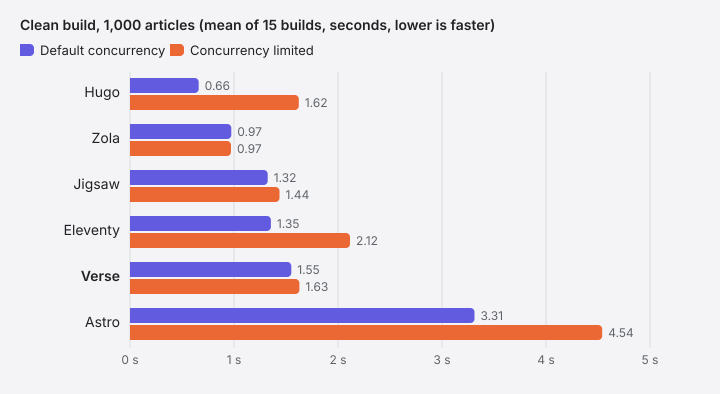
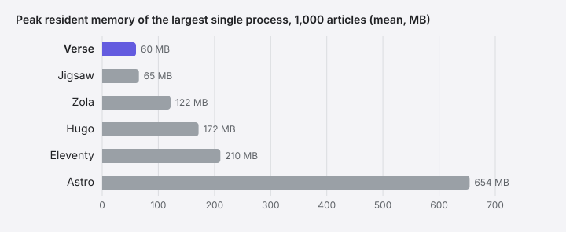

[Verse](https://github.com/astrophp/verse) is the static site generator that builds this site. I wrote it, and I wanted to know how v0.3.2 compares with other generators on the kind of blog it was built for.

I also wrote the benchmark configurations for the other tools. Their maintainers have not reviewed them.

This is mostly a record for myself: where Verse stands today, where its build time goes, and a baseline I can return to when comparing future releases.

## The short version

- **Verse is not the fastest.** For 1,000 articles with default concurrency, Hugo (0.66 s) and Zola (0.97 s) are clearly faster than Verse (1.55 s), and Jigsaw (1.32 s) and Eleventy (1.35 s) are somewhat faster. Only Astro (3.31 s) is slower.
- **With concurrency limited, the picture changes for Hugo but not for Zola.** Zola still averages 0.97 s at 1,000 articles. Verse takes about 13% longer than Jigsaw, while Verse and Hugo have similar average build times: 1.63 s and 1.62 s.
- **Code blocks accounted for less of the build than I expected.** Code-block processing, including highlighting, accounted for about 7% of the build time in this workload. Most of the time went into rendering Markdown and Blade templates and writing the generated HTML.
- **Verse recorded the lowest peak process memory at 1,000 articles:** about 60 MB, followed by Jigsaw at about 65 MB.

## What was measured

I gave six static site generators the same generated articles and configured them to produce the same set of blog features, then built them on my laptop:

| Tool | Version | Language / runtime |
|---|---|---|
| Verse | 0.3.2 | PHP |
| Jigsaw | 1.8.8 | PHP (Laravel Blade) |
| Hugo | 0.168.0 | Go |
| Zola | 0.23.6 | Rust |
| Eleventy | 3.1.7 | Node.js |
| Astro | 7.4.1 | Node.js |

The content was 100 or 1,000 generated articles of about 500 words. Each had four sections, a list, a table, inline code and links, one short PHP code block, and two tags out of twenty. Each tool had to produce the following pages and features:

- the same URLs: a home page, a paginated archive, paginated tag pages, a tag index, an about page and a 404 page;
- a `search.json` index;
- a `sitemap.xml`;
- a table of contents on every article;
- code highlighting at build time, not in the browser.

All of them produced 134 pages for 100 articles and 1,304 pages for 1,000.

The same features do **not** mean the same design. Verse built its full bundled theme. The others got minimal templates written for this benchmark. As a result, Verse's output is much heavier: about 16 MB at 1,000 articles, against roughly 6.5 MB for the others, more than twice the size.

Each tool was built 15 times per size: five cycles of three rounds, interleaved, with the tool order rotating every cycle and an untimed warm-up first. Before every timed build, I removed the output directory and the tool's build caches. The operating system's file cache remained warm. Timings include process start-up and exclude the cleanup before them. The numbers below are the means of those 15 builds.

## Default concurrency

These are the build times for the configured benchmark sites, using each tool's normal concurrency settings.

| Tool | 100 articles | 1,000 articles |
|---|---|---|
| Hugo | 0.08 s | 0.66 s |
| Zola | 0.45 s | 0.97 s |
| Jigsaw | 0.24 s | 1.32 s |
| Eleventy | 0.38 s | 1.35 s |
| **Verse** | **0.28 s** | **1.55 s** |
| Astro | 1.32 s | 3.31 s |

At 1,000 articles, Hugo is about 2.3 times as fast as Verse and Zola about 1.6 times. Verse takes 14–17% longer than Eleventy and Jigsaw. At 100 articles everything except Astro finishes in under half a second, and the differences matter less than the numbers suggest.

Not every tool uses one core. I compared the CPU time of each build to its wall time:

| Tool | Cores in use |
|---|---|
| Hugo | ~2.8 |
| Zola | ~2.7 |
| Eleventy | ~1.5 |
| Astro | ~1.3 |
| Jigsaw | ~0.9 |
| Verse | ~0.9 |

The figures are for 1,000 articles. Jigsaw and Verse run as a single PHP process.

## Concurrency limited

To separate "does less work" from "uses more cores", I ran everything again with each tool's concurrency limited to about one core. The settings were:

- `GOMAXPROCS=1` for Hugo;
- `RAYON_NUM_THREADS=1` for Zola;
- `node --single-threaded` plus thread-pool limits for Eleventy and Astro;
- nothing for Jigsaw and Verse, which are already single-process.

These are runtime settings, not an identical CPU allocation enforced by the operating system; macOS cannot pin a process to a core. Averaged per tool and size, the ratio of CPU time to wall time stayed between 0.73 and 1.06, which says the limits held.

| Tool, concurrency limited | 100 articles | 1,000 articles |
|---|---|---|
| Zola | 0.21 s | 0.97 s |
| Jigsaw | 0.28 s | 1.44 s |
| Hugo | 0.20 s | 1.62 s |
| **Verse** | **0.31 s** | **1.63 s** |
| Eleventy | 0.66 s | 2.12 s |
| Astro | 2.16 s | 4.54 s |

Two things stand out:

- **Hugo's lead comes from parallelism.** With concurrency limited it averages 1.62 s, about the same as Verse.
- **Zola's lead does not.** It averages 0.97 s either way. With default concurrency it kept almost three cores busy and finished no sooner. Limited, it still does the same work in about 60% of Verse's time.

The closest comparison is Jigsaw. It is also PHP and Blade, also a single process, and it used the same highlighter library as Verse (tempest/highlight), because it has none of its own. Verse took about 13% longer than Jigsaw with concurrency limited and about 17% longer with default concurrency.

> [!NOTE]
> Hugo's concurrency-limited mean at 100 articles (0.20 s) is pulled up by one noisy cycle. Its median is 0.16 s.

## Where Verse's build time goes

My guess going in was code blocks: highlighting looked like the expensive part. So I measured where a v0.3.2 build of 1,000 articles spends its time, in a separate run of five builds. A script repeated Verse's build steps with a timer around each one, and a second script timed the Markdown of every article in three versions:

- as written;
- with the code block kept but marked as plain text, so it is not highlighted;
- with the code block removed.

The differences between those versions give the cost of highlighting and of the rest of the code block. The numbers below are means of the five runs; the whole build averaged 1.52 s in this run.

The guess was wrong:

- **The code block costs about 0.11 s**, about 7% of the build, highlighting included. Measured as Markdown with and without the block, so it covers parsing and producing the block's HTML, not writing it to disk.
- **Highlighting alone is about 0.065 s.** Jigsaw runs the same highlighter on the same block.
- **Markdown without the code block takes about 0.49 s.**
- **Blade views and the rest of page rendering take about 0.42 s.** This figure is inferred: total render time minus the Markdown time, which was measured in a separate script.
- **Writing 15.5 MB of HTML takes 0.22 s**, about 15% of the build. Part of that is the price of the heavier theme.
- **The search index, sitemap and theme assets together take 0.007 s**, under half a percent. Validating the output before publishing takes 0.04 s.

The parts add up to 1.39 s. The remaining ~0.1 s of the whole build is starting PHP and the command line, and moving the finished output into place.

So the features in the spec cost almost nothing. Verse's time goes into turning Markdown into HTML, rendering it through Blade, and writing out a fuller page than the other tools produce. This breakdown only covers Verse's own build. It does not tell me why Jigsaw does the same kind of work faster: I did not measure Jigsaw part by part, so I can't say which of these accounts for the 0.2 s between them.

## Where Verse comes out ahead

### Memory

The metric here is peak resident memory (RSS): the physical memory a process held at its highest point. It was taken for the largest single process of each build, without adding up child processes, so it would undercount a tool that splits its work across processes.

By that measure, at 1,000 articles with default concurrency, Verse averaged about 60 MB. Jigsaw is close at about 65 MB, and the others ranged from about 122 MB (Zola) to 654 MB (Astro).

### What it took to build the same site

The spec was the same for everyone, but the work needed to meet it was not. Counting the configuration and template files in each benchmark project, without the content:

| Tool | Files written | Extra packages |
|---|---|---|
| Verse | 1 (`verse.yaml`) | none |
| Hugo | 10 | none |
| Zola | 10 | none |
| Eleventy | 13 | syntax highlighting, heading anchors |
| Astro | 16 | none |
| Jigsaw | 15 | tempest/highlight |

This needs reading carefully. Hugo, Zola and Astro have highlighting, sitemaps and tables of contents built in; most of the files written for them are page templates, the part Verse's bundled theme covers. That is also the trade-off: Verse ships one bundled theme, and a website does not carry its own theme files. The other tools let you design the site from scratch, and Verse does not yet.

### Safe builds

Build time is not the only thing a build tool is judged on. Verse is strict in ways a benchmark does not show:

- **Staged output.** `verse build` writes the site to a staging folder first. It replaces `dist/` only when every step has succeeded, so a failed build leaves the last good site untouched.
- **A marked output folder.** Verse refuses to overwrite a `dist/` folder it did not create.
- **Content is never executed.** Raw HTML in Markdown is escaped, and content is never run as PHP or Blade.
- **Specific errors.** An invalid setting or a misplaced file fails with an error naming the field or the file.

The 0.04 s validation step in the breakdown above is part of that.

This matters more to me than a few hundred milliseconds. A typo or a bad file should fail the build, not publish a half-built site. I'd rather a build stop than deploy something broken.

## What this does not tell you

- **One machine.** An Apple M1 Pro laptop on macOS with other apps open, not an idle benchmark server. Treat differences under about 10% as ties.
- **One kind of content.** Generated articles with one code block each and no images. Real sites differ.
- **Clean builds only.** Incremental builds, dev-server rebuilds, install size, developer experience and ecosystems were not measured. For most sites those matter more than a second of build time.
- **Different designs.** Verse's output is more than twice the size of the others'. Same pages, same data, not the same HTML.
- **My setups, not theirs.** I wrote the competitor setups, with help from AI coding tools, and nobody who maintains those tools has checked them. They may not be configured the way an expert would configure them.
- **Zola's build** includes deleting the `/page/1/` redirect pages it generates, so its URLs match. That takes a few milliseconds.

## How this was done

I used AI coding assistants (Claude, with reviews from Codex and Opus) for the harness, the profiling and the fixes. The process made mistakes along the way, and they were caught before the final run:

- **Xdebug.** The first PHP numbers were taken with Xdebug loaded. Its default mode made Verse and Jigsaw about three times slower. Every number above was measured with `XDEBUG_MODE=off`. If you benchmark PHP tools yourself, check this first.
- **An unfair first draft.** The first comparison gave Verse its full theme and gave the others no highlighting. It was thrown away and redone against a written spec, with a checker script.

## Enough for now

I built Verse for myself, and building it teaches me how a static site generator works inside: how Markdown becomes HTML, how links between pages resolve, and what a build should refuse to publish. It doesn't need to be the fastest to do that. It already builds 1,000 articles in under two seconds, less than a second behind the fastest tool here, and it does that job well.

Benchmarks like this one can push you into over-engineering. You start chasing the top of a chart and find yourself solving problems you don't actually have. Verse is enough for now, and I'd rather spend my time on what building it teaches me than on the last few hundred milliseconds.
