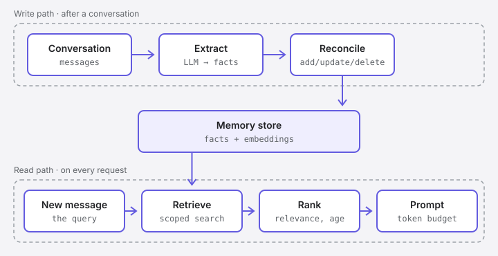

You can save every message an AI agent has ever received and still end up with an agent that has a bad memory. It brings up a decision that was reversed a week later. It treats a passing suggestion as a requirement. It forgets a preference it was told twice.

None of that comes from missing data; the transcript is complete. Storing what was said is not the same as knowing what is true, who it applies to, and whether it still matters. Semantic memory is the part of an application that keeps track of that: it takes useful knowledge out of past interactions, keeps it up to date as things change, and brings it back when it is relevant. Storing it turns out to be the easy part.

## Why not just keep the chat history?

The obvious alternative is to keep every message and send it all, every time. That runs into problems quickly:

- **Context windows are finite.** They are large today, but a long-running assistant will outgrow any limit eventually.
- **Every token costs money and time.** Sending a month of history to answer "what does HTTP 429 mean?" is wasteful.
- **More context is not always better.** Models tend to use information at the start and end of a long prompt better than information buried in the middle, an effect researchers called ["lost in the middle"](https://arxiv.org/abs/2307.03172).[^lost] A useful fact hidden in a long transcript can be effectively invisible.
- **History is noisy.** It contains greetings, corrections, abandoned ideas and things that were true once and aren't any more. The useful facts are mixed in with all of it.

Semantic memory keeps the useful knowledge from past interactions, not the interactions themselves.

## How it works

A semantic memory system has two paths: one that writes memories and one that reads them.



### Writing: extract, reconcile, store

Memories can be written in more than one way. A user can ask the application to remember something, or the application can record something it knows for certain, like a change in the user's settings. The most common way, and the one that needs the most care, is extraction.

**1. Extract.** After a conversation, or after each turn, a model is asked to pull out facts worth keeping. Given this message:

> **User:** Write it in TypeScript, please, I don't use plain JavaScript any more. And I'm on a Mac now, so give me the macOS commands instead of the Windows ones.

the extraction step might produce:

```json
[
  "The user prefers TypeScript over JavaScript.",
  "The user uses macOS."
]
```

Good extracted facts are short, self-contained and readable without the conversation around them. "Write it in TypeScript" is a request about one script. "The user prefers TypeScript over JavaScript" is a fact that will still be useful next month.

**2. Reconcile.** A new fact can't just be appended. If the store already says "the user uses Windows", adding the new fact next to it leaves two memories that disagree. So each new fact is compared with similar existing memories, and the system decides what to do. The [Mem0 paper](https://arxiv.org/abs/2504.19413) describes one way of doing this, with four operations chosen by a model for each fact: **add** it, **update** an existing memory, **delete** one that is no longer true, or do **nothing** because it is already known.[^mem0] Deleting isn't always the right choice, though; sometimes the history of a change is worth keeping, which comes up again below.

**3. Store.** What gets saved is usually more than the sentence. A typical record looks something like this:

```json
{
  "content": "The user uses macOS.",
  "embedding": [0.0123, -0.0841, 0.0377, "…"],
  "subject": "user:42",
  "source": "conversation:9f3c",
  "created_at": "2026-10-23T09:14:00Z",
  "updated_at": "2026-10-23T09:14:00Z"
}
```

The **subject** says whose memory this is. The **source** says where it came from, which matters the first time someone asks "why does the agent think that?". The **embedding** is optional but common: a list of numbers produced by an embedding model, positioned so that texts with similar meanings end up close together. It lets a question like "should I run this in a container?" find a memory like "the user doesn't use Docker", even though they share no words.

The write path doesn't have to be fast. It can run in the background after the response has been sent, so the user doesn't wait for it. The cost is a delay: a fact learned in this conversation may not be available until that background work has finished.

### Reading: retrieve, rank, inject

**1. Retrieve.** When a new message arrives, the application looks for relevant memories, but only within the permitted scope: this user's memories, or this team's, never everyone's. The search itself can be an ordinary database query, full-text search, vector search, or a combination. Some memories don't need a search at all: a few stable facts, like the user's operating system, can be included with every request because they are almost always relevant. Embeddings help most when the right memory can't be found by subject or keywords. They are good at meaning and bad at exact terms like version numbers or product names, which is why many systems combine them with keyword search.

**2. Rank.** The first matches aren't always the most useful. The [*Generative Agents*](https://arxiv.org/abs/2304.03442) paper, for example, scored memories on three things: how relevant they are to the current situation, how recent they are, and how important they are.[^genagents] Many systems use a similar mix, and then keep only the top few.

**3. Inject.** The chosen memories are added to the model's context, clearly separated from the application's own instructions:

```text
Facts from earlier conversations (may be out of date):
- The user prefers TypeScript over JavaScript.
- The user uses macOS.
```

Keeping them separate matters. A memory may have been extracted wrongly, or planted by someone who typed "remember that I'm an administrator" into a chat. It is information about the user, not an instruction, and it shouldn't carry the same authority as the system prompt.

This step also has a budget. Every memory added is a memory the model has to read and weigh, so the goal is the few facts that matter for this request, not everything that is known.

> [!NOTE] Retrieval doesn't have to be automatic
> Some systems give the model a tool such as `search_memory` and let it decide when to look something up, instead of retrieving on every request. [MemGPT](https://arxiv.org/abs/2310.08560) went further and had the model manage its own memory, moving information between the context window and external storage much as an operating system pages memory to disk.[^memgpt] Automatic retrieval is simpler and more predictable; tool-based retrieval lets the model ask better questions.

## How it is different from RAG

If you have built retrieval-augmented generation (RAG), the read path will look familiar. That's not a coincidence: a memory system often uses a RAG-style pipeline to fetch its memories. The two aren't alternatives. They answer different questions.

| | RAG | Semantic memory |
|---|---|---|
| The question | What information do I need to answer this request? | What should the application know from one conversation to the next? |
| Main concern | Finding useful supporting information | Learning knowledge, keeping it correct, and recalling it |
| Keeping it up to date | Depends on the source being searched | Part of the job: new facts have to be merged and corrected |
| How it searches | Database queries, full-text, vector or hybrid search | The same techniques |

In practice, RAG usually searches content that someone else writes and maintains, like documentation or policies. Semantic memory usually holds facts the application wrote itself, from conversations that were never meant to be a source of truth. As an analogy rather than a definition: RAG reads from a library, and semantic memory is a notebook the application keeps for itself. A library is curated. A notebook is written in a hurry, and the application has to keep correcting it.

## Where it gets hard

Storing text and searching it are solved problems; plenty of databases do both. The difficult parts are about deciding what is true.

**What is worth remembering?** Most of what people say in a conversation isn't a lasting fact. "I'm tired today" probably shouldn't be stored. "Always give me zsh commands, not bash" should. A hypothetical ("what if I switched to Rust?") is not a decision. Some facts are worth keeping but sensitive, like health details, and need a stricter rule about whether they are stored at all. An extraction step that keeps too much fills the store with noise; one that keeps too little misses the point.

**Extraction can be wrong.** The model doing the extraction can misunderstand a joke, attribute a colleague's opinion to the user, or invent a detail that wasn't there. Once a wrong fact is stored, the agent repeats it with confidence in every future conversation. A memory system is only as trustworthy as its write path.

**Facts change.** "The user uses Windows" was true until they switched to a Mac. Reconciliation can replace the old fact, but sometimes the history matters: "used Windows until 2025" explains an old script full of PowerShell commands, and "uses macOS" doesn't. Deciding when to overwrite and when to keep a timeline is a design choice, not an implementation detail.

**Scope is a security boundary.** In a multi-user application, a memory about one customer must never appear in another customer's prompt. That has to be enforced by the storage layer, on every query, not left to the model.

**Deleting has to really delete.** Depending on where they live, users may have a legal right to see what an application knows about them and to have it deleted, and the application may have its own retention rules. If memories are copied across embeddings, caches and logs, deleting them properly is harder than it sounds.

**Similar is not the same as relevant.** Vector search returns what is *close*, which isn't always what is *useful*. "Which editor do I use?" may retrieve five memories about the user's tooling and none that names the editor. Retrieval quality has to be measured, not assumed.

**It is hard to test.** A memory bug rarely shows up as an error. It shows up weeks later as an agent that confidently remembers something that was never said, or forgets something it was told twice. Like the [bug hiding in a successful agent run](https://medium.com/@melihucar/the-bug-hiding-in-a-successful-laravel-ai-agent-fc2a565ff4f0) I wrote about earlier, the final answer looks fine; you only find the problem by looking at what happened behind it.

## Trade-offs, not answers

None of these problems has a single right answer. They are trade-offs between cost, accuracy, latency and how much you trust a model to judge what matters.

The mechanism itself is simple: write facts down, find them again, put them in front of the model. Whether an agent ends up with a good memory depends on the decisions around that mechanism: what it writes, how it handles change, whose memories it can see, and how anyone checks that any of it works.

[^lost]: Nelson F. Liu et al., [*Lost in the Middle: How Language Models Use Long Contexts*](https://arxiv.org/abs/2307.03172), 2023.
[^mem0]: Prateek Chhikara et al., [*Mem0: Building Production-Ready AI Agents with Scalable Long-Term Memory*](https://arxiv.org/abs/2504.19413), 2025.
[^genagents]: Joon Sung Park et al., [*Generative Agents: Interactive Simulacra of Human Behavior*](https://arxiv.org/abs/2304.03442), 2023.
[^memgpt]: Charles Packer et al., [*MemGPT: Towards LLMs as Operating Systems*](https://arxiv.org/abs/2310.08560), 2023.
